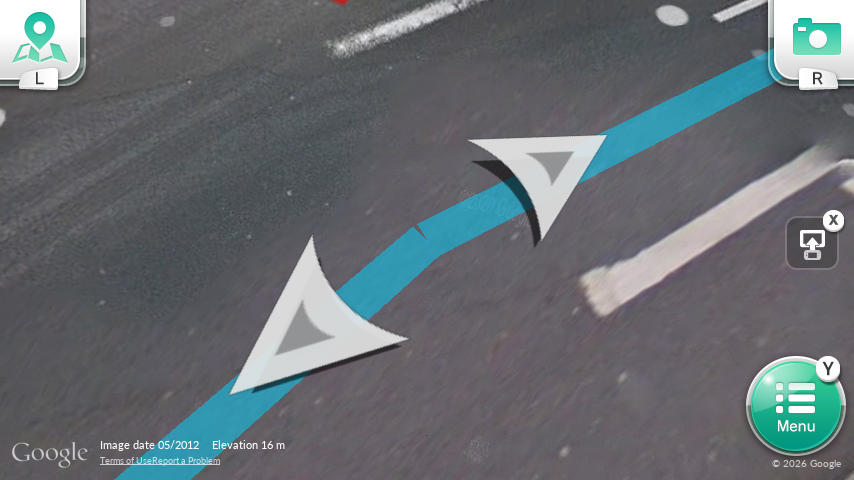
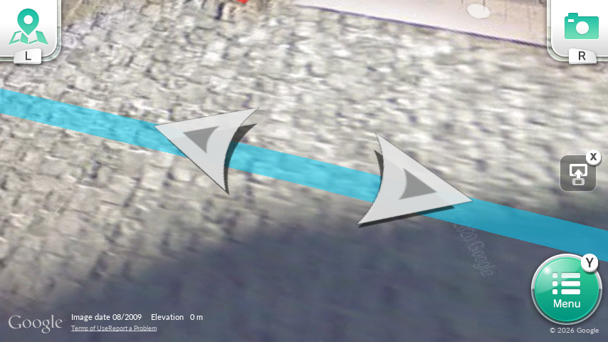

<div align="center">

# Cemu Aroma

**Wii U Aroma plugins, running inside Cemu.**

Created by **Little_mac**. To our knowledge, this is the world’s first Wii U emulator fork to run Aroma WPS plugins directly.

[](LICENSE.txt)
[](README-AROMA.md)
[](README-PYTHON.md)
[](docs/VALIDATION.md)

[Quick start](#quick-start) · [Plugin compatibility](#plugin-compatibility) · [Architecture](README-AROMA.md) · [Validation](docs/VALIDATION.md) · [Changelog](CHANGELOG.md)




*London and Paris, captured from one Vulkan session on a Radeon RX 6700 XT.*

</div>

The same plugin file used on a Wii U can run its PowerPC startup code in Cemu. For Wii Street U Revival, that means SD Cafiine supplies the content from the emulated SD card and the Revival plugin serves live map and panorama data. Python can inspect the running guest from a terminal while the title is on screen.

## Quick start

1. Clone this repository recursively (`git clone --recursive https://github.com/Littlemac123/Cemu-Aroma.git`) and follow the platform dependencies in the [build guide](BUILD.md). The verified configuration used Linux.
2. Prepare your own dumped title and plugin files. For Wii Street U, follow the [Revival setup](https://github.com/Littlemac123/WiiStreetU-Revival) and place the prepared content in Cemu’s emulated SD card.
3. Launch the title with SD Cafiine first and Revival second. Use the executable path produced by your build.

```sh
./bin/Cemu_relwithdebinfo --forward-console-logging \
  --aroma-plugin /path/to/sdcafiine.wps \
  --aroma-plugin /path/to/WiiStreetU-Direct.wps \
  -g /path/to/WiiULauncher.rpx
```

Add `--python-debug` to attach the [Python debugger](README-PYTHON.md). That option stops at title entry until you resume or detach. For a first launch, check the log for SD Cafiine’s content merge, Revival’s `wsudata:/` mount, and a successful tile request.

## Plugin compatibility

| Component | Verified behavior | Open work |
| --- | --- | --- |
| Wii Street U Revival | Live map, panoramas, and consecutive searches in an isolated Cemu profile | Broader stability and platform coverage |
| SD Cafiine | Loads prepared content from the emulated SD card alongside Revival | Configuration UI and settings writes |
| GiveMiiYouTube | Plugin replacement, guest search, and video playback observed in a Linux Vulkan interpreter test | Recompiled startup and intermittent video presentation |
| WUMS modules | Linking and lifecycle callbacks exercised with fixture modules | Full Aroma runtime and original settings menu |

<details>
<summary><strong>How the fork runs an Aroma plugin</strong></summary>

The loader maps the WPS image into guest memory, resolves its imports, and dispatches supported hooks in the emulated title. Cemu supplies compatibility exports for services the tested plugins use. The optional WUMS path links module images and dispatches supported lifecycle hooks. This is a targeted Aroma runtime inside Cemu’s existing Wii U emulation. [Architecture and research notes](README-AROMA.md)

</details>

<details>
<summary><strong>What the validation run covered</strong></summary>

The Radeon Vulkan run submitted two distinct searches, loaded the corresponding panoramas, and exited with status zero. Vulkan validation reported zero errors in that run. [Test procedure and known limits](docs/VALIDATION.md)

</details>

## Credits

**Little_mac** created this fork. Thanks to the upstream Cemu contributors and the Wii U homebrew developers behind Aroma, WUPS, WUMS, SD Cafiine, and the plugins used for compatibility testing.

## Upstream Cemu

[](https://github.com/cemu-project/Cemu/actions/workflows/build.yml)
[](https://discord.gg/5psYsup)

This is the code repository of Cemu, a Wii U emulator that is able to run most Wii U games and homebrew in a playable state.
It's written in C/C++ and is being actively developed with new features and fixes.

Cemu is currently only available for 64-bit Windows, Linux & macOS devices.

### Links:
 - [Open Source Announcement](https://www.reddit.com/r/cemu/comments/wwa22c/cemu_20_announcement_linux_builds_opensource_and/)
 - [Official Website](https://cemu.info)
 - [Compatibility List/Wiki](https://wiki.cemu.info/wiki/Main_Page)
 - [Official Subreddit](https://reddit.com/r/Cemu)
 - [Official Discord](https://discord.gg/5psYsup)
 - [Setup Guide](https://cemu.cfw.guide)

#### Other relevant repositories:
 - [Cemu-Language](https://github.com/cemu-project/Cemu-Language)
 - [Cemu's Community Graphic Packs](https://github.com/cemu-project/cemu_graphic_packs)

## Download

You can download the latest Cemu releases for Windows, Linux and Mac from the [GitHub Releases](https://github.com/cemu-project/Cemu/releases/). For Linux you can also find Cemu on [Flathub](https://flathub.org/apps/info.cemu.Cemu).

On Windows, Cemu is available both as an installer and in a portable format, where no installation is required besides extracting it in a safe place.

The native macOS build is currently purely experimental and should not be considered stable or ready for issue-free gameplay. There are also known issues with degraded performance due to the use of MoltenVK and Rosetta for ARM Macs. We appreciate your patience while we improve Cemu for macOS.

Pre-2.0 releases can be found on Cemu's [changelog page](https://cemu.info/changelog.html).

## Build Instructions

To compile Cemu yourself on Windows, Linux or macOS, view [BUILD.md](/BUILD.md).

## Issues

Issues with the emulator should be filed using [GitHub Issues](https://github.com/cemu-project/Cemu/issues).  
The old bug tracker can be found at [bugs.cemu.info](https://bugs.cemu.info) and still contains relevant issues and feature suggestions.

## Contributing

If you want to contribute you can take a look at our [contribution guidelines](/CONTRIBUTING.md).

## License
Cemu is licensed under [Mozilla Public License 2.0](/LICENSE.txt). Exempt from this are all files in the dependencies directory for which the licenses of the original code apply as well as some individual files in the src folder, as specified in those file headers respectively.
